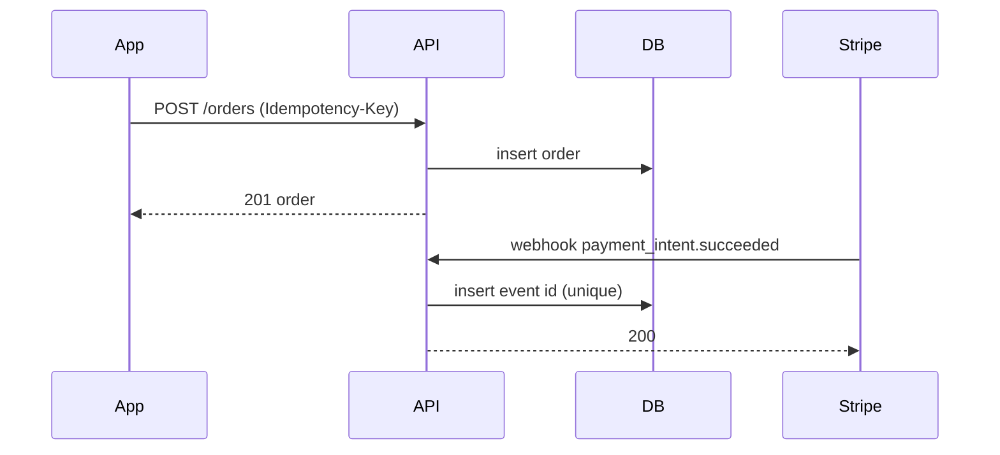

# Explanation templates

Contents: 1. Decision record. 2. Change brief. 3. Trade-off table. 4. Design doc sections. 5. One-paragraph
summary. 6. Review comments. 7. Diagrams. 8. Worked app examples.

## 1. Decision record

```
# Title (a present-tense imperative phrase)

## Status
Proposed | Accepted | Superseded by ADR-00XX

## Context
The forces at play, technical, business, and political, stated as neutral fact.

## Decision
The change being made, stated actively: "We will..."

## Consequences
What becomes easier and what becomes harder. Both directions, not just the upside.
```

Decision records are immutable. A changed decision is a new record that supersedes the old one, never an edit.
The value is the history, and editing destroys it.

Worked example title lines that follow the convention: "Store auth tokens in the platform keychain", "Use pool
tenancy with a tenant_id column", "Ship Android and iOS from one Expo project".

## 2. Change brief

- **First line**: a short summary of what is being done, a complete sentence written as an order. It stands
  alone; a reader should never need the body to understand it.
- **Blank line.**
- **Body**: the problem being solved, why this is the best approach, and any shortcomings of the approach,
  stated explicitly. Plus issue numbers, benchmark results, and links, because links rot and future readers do
  not have your context.
- **A line naming what was deliberately not done.**

Banned first lines, verbatim: "Fix bug." "Fix build." "Add patch." "Moving code from A to B." "Phase 1."
"Add convenience functions."

Size discipline: around 100 lines is a reasonable change; 1000 is usually too large. Watch file spread as well
as line count. 200 lines in one file is fine; the same 200 lines across 50 files usually is not. A whole-file
deletion counts as roughly one line of change, and a fully-trusted automated refactor is a sanctioned
exception.

## 3. Trade-off table

Rows are the options, including "do nothing". Columns are the two to four goals that actually matter. Cells
say how each option scores against that goal, concretely.

| Option | Offline correctness | Build cost | Ops burden | Reversible |
|---|---|---|---|---|
| Queued mutations plus refetch | Good for independent writes, fails on concurrent edits | Low | None beyond the queue | Yes |
| Sync engine | Strong | High | A replication service to operate | Costly |
| Do nothing | The app is unusable on a train | Zero | None | Yes |

State plainly what each rejected option lost on. Hand-waving the rejection is how a decision gets relitigated
three months later.

## 4. Design doc sections

Context and Scope, then Goals and Non-Goals, then The Actual Design, then Alternatives Considered, then
Cross-Cutting Concerns.

Non-goals are precisely "things that could reasonably be goals, but are explicitly chosen not to be goals".
That is the citable definition of what you did not do, and it is not the same as a caveat.

Alternatives Considered shows explicitly why the selected solution is best given the stated goals, and how the
others introduce trade-offs that are less desirable given those same goals. If the goals are not stated, the
section cannot do its job.

## 5. One-paragraph summary

Conclusion or ask in sentence one. Everything after is skippable support. This is the level-one disclosure
layer and it must stand alone if the reader stops there.

Test it: delete every sentence after the first. Does the reader still know what to do? If not, the first
sentence is throat-clearing.

## 6. Review comments

Format: `<label> [decorations]: <subject>`, then optional discussion.

| Label | Blocking | Use for |
|---|---|---|
| `issue` | Yes | Something wrong that must change |
| `suggestion` | Usually | A specific proposed change |
| `todo` | Yes, small | A small necessary follow-up in this change |
| `question` | Depends | You genuinely do not know |
| `chore` | Yes, small | Process work: changelog, ticket link |
| `nitpick` | No | Preference, stated as preference |
| `thought` | No | An idea that does not need action |
| `note` | No | Context for the reader |
| `praise` | No | A specific thing done well, named specifically |

Labeling non-blocking comments as non-blocking is the whole point. An unlabeled nitpick reads as a blocker and
costs a round trip.

## 7. Diagrams

A diagram wins for topology, flow, hierarchy, call graphs, and state machines. A table wins for comparing more
than two discrete dimensions. Do not force a flowchart onto a comparison, and do not force a table onto a
sequence.



Use Mermaid where it renders (GitHub, many Markdown viewers, VS Code with the extension). Use ASCII boxes in a
terminal or a plain-text log.

## 8. Worked app examples

**Explaining a slow screen, level one:**

> The feed takes about 2.4s to become interactive on a mid-tier Android device, p90. Roughly 1.6s of that is
> spent in app init before the first frame, not in fetching the feed. `[VERIFIED: adb am start -S -W, 5 runs]`
> Moving analytics and crash SDK init off the startup path is the change with the largest expected effect.
> This holds unless the init work is genuinely required before first paint, which is worth checking for the
> crash SDK specifically.

Level two adds the trace breakdown, the specific init calls, and the regression gate. Not a third level.

**Explaining why a fix cannot ship over the air:**

> This change adds a camera permission, which lives in the native manifest. Over-the-air updates carry JS and
> assets only, so this needs a new binary and a new review. `[VERIFIED: the diff touches app.json ios.infoPlist]`
> The JS-only part of the fix could ship over the air today, but it would be inert without the permission.
