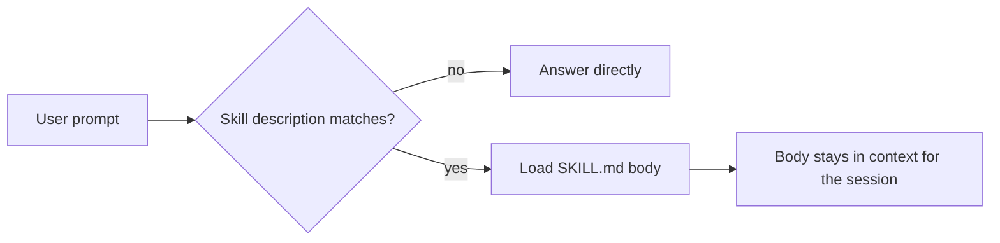

# Explanation templates

Copy the shape, replace the content. Every template below is in use somewhere real; none is invented for this
file.

## Contents

1. Decision record
2. Change brief
3. Trade-off table
4. One-paragraph summary
5. Review comments
6. Diagrams in text
7. Failure explanation
8. Delivery structures, by reader need

## 1. Decision record

```markdown
# Title, a present-tense imperative phrase

## Status
Proposed | Accepted | Superseded by ADR-00XX

## Context
The forces at play, technical and organizational, stated as neutral fact.

## Decision
The change being made, stated actively: "We will ..."

## Consequences
What becomes easier and what becomes harder. Both directions, not only the upside.
```

Decision records are immutable. A changed decision is a new record superseding the old one, never an edit. The
value is the history, including the reasoning that later turned out to be wrong.

## 2. Change brief

```
<Imperative first line, a complete sentence, standing alone as a summary.>

<Problem being solved, and why this approach.>

<Shortcomings of the approach. Required, not optional.>

<What this change deliberately does not do.>

<Bug numbers, benchmark output, links. Links rot; paste the number that matters.>
```

The first line is written as though it were an order: "Delete the FizzBuzz RPC and replace it with the new
system." Never a gerund, never a category. Anti-patterns, verbatim: "Fix bug", "Fix build", "Add patch",
"Moving code from A to B", "Phase 1", "Add convenience functions".

Size discipline: 100 lines is usually a reasonable change and 1,000 is usually too large. Spread matters as
much as count. A 200-line change in one file is fine; the same 200 lines across 50 files usually is not.
Whole-file deletion counts as roughly one line of change, and a fully trusted automated refactor is a
sanctioned exception.

## 3. Trade-off table

Rows are the options actually considered, including doing nothing. Columns are the two to four goals that
decide it. Cells say how each option scores. The rejected options' losses are stated, not hand-waved.

| Option | Cost to build | Ongoing context cost | Failure mode |
|---|---|---|---|
| Do nothing | none | none | the same correction keeps recurring |
| Memory line | minutes | every request, forever | ignored once the file grows past 200 lines |
| Path-scoped rule | minutes | only when a matching file is read | lost after compaction until it retriggers |
| Hook | an hour | none until it fires | fails silently without the execute bit |

Surrounding sections, when the document is long enough to need them: context and scope, goals and non-goals,
the actual design, alternatives considered, cross-cutting concerns. Alternatives considered is where an
explanation earns trust, by showing why the selected option wins given the stated goals.

## 4. One-paragraph summary

Conclusion or ask in sentence one. Everything after it is skippable support. This is the level-1 disclosure
layer and it must stand alone without the rest of the document.

Test it by deleting everything else. If a reader who sees only that paragraph would act correctly, it works.

## 5. Review comments

Syntax: `<label> [decoration]: <subject>`, then optional discussion.

| Label | Blocking | Use for |
|---|---|---|
| `issue:` | yes | something wrong that must change |
| `suggestion:` | usually | a concrete proposed change |
| `todo:` | yes | a small required follow-up |
| `question:` | depends | you need information before deciding |
| `nitpick:` | no | a preference, explicitly minor |
| `thought:` | no | an idea worth recording, not a request |
| `note:` | no | information the author should have |
| `chore:` | usually | a process step such as updating a changelog |

Labeling is the whole point: a reader can separate what blocks from what does not without inferring tone.

## 6. Diagrams in text

Mermaid is the default in a Claude Code workflow: plain text, renders in many Markdown viewers, and needs no
round trip. ASCII boxes are the fallback when the target surface will not render Mermaid, such as a terminal or
a log.



A diagram wins for topology, flow, and hierarchy. A table wins for comparing more than two discrete
dimensions. Choose by the shape of the content, not by which one looks more thorough.

## 7. Failure explanation

```
WHAT HAPPENED : the observable, quoted
WHY           : the mechanism, one or two sentences
EVIDENCE      : the command and its real output
CONFIDENCE    : one band, attached to the why
FIX           : the smallest change that addresses the mechanism
RECHECK       : the same command, run again, with its output
```

Every field is filled or explicitly marked unknown. An explanation missing EVIDENCE is a hypothesis, and
saying so costs one word.

## 8. Delivery structures, by reader need

| Structure | Use when | Core move |
|---|---|---|
| Conclusion first | the reader must act: reply, approve, ship | the ask in sentence one |
| Inverted pyramid | the reader skims for facts | most important fact first, expendable tail |
| Scene then thesis | the reader's attention must be earned | a concrete scene, then why they are reading this, early |
| Situation, complication, question, answer | the reader must be persuaded | they arrive at the question one beat before the answer |
| Point, evidence, explanation, link | a graded analytical argument | the explanation names the actual mechanism rather than "this shows that" |
| Accomplished X, measured by Y, by doing Z | scanned in seconds | one line, one number |
| Ladder of abstraction | the topic is inherently abstract | never abstract for more than two sentences; drop to a name or a number |
